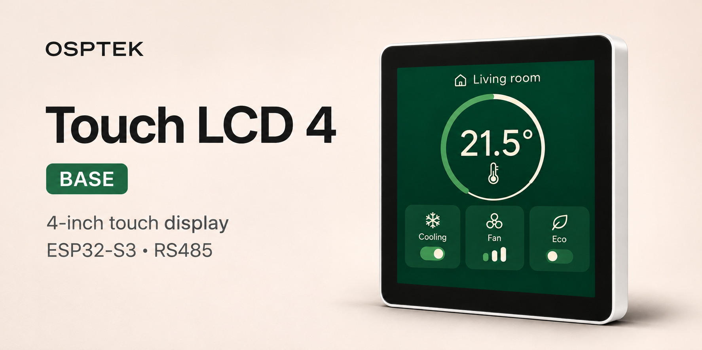
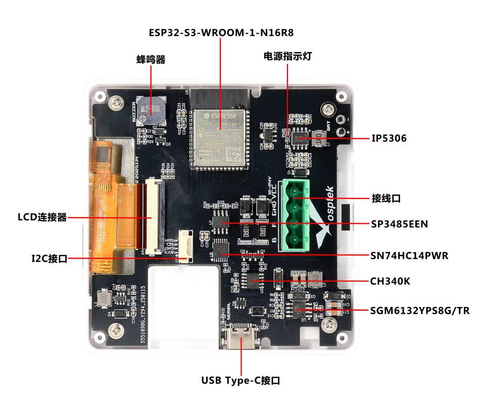
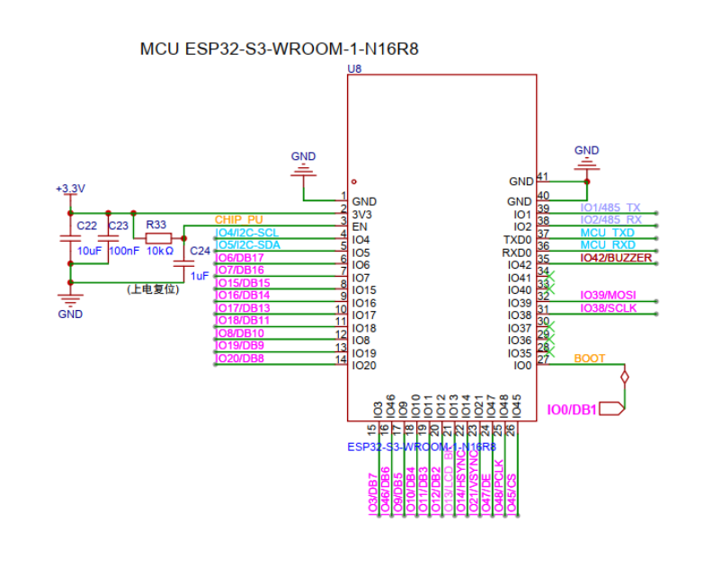
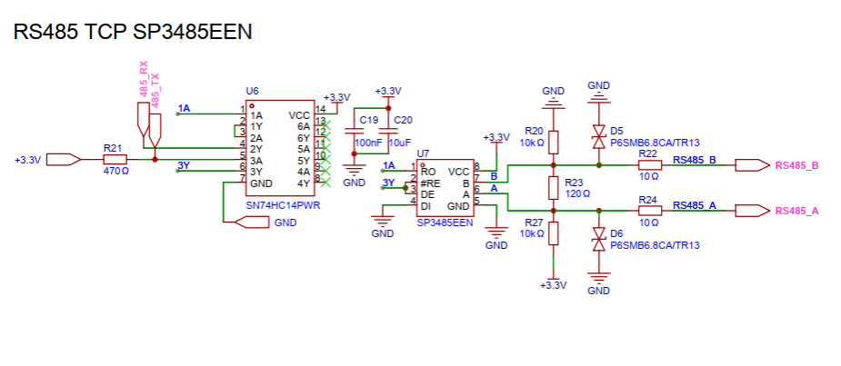

<p align="left"></p>

<h1 align="center">ESP32-S3 Touch LCD 4 · Base</h1>

<p align="center">A touch panel that connects the interface to field devices.</p>

<p align="center">English | <a href="./README.md">简体中文</a></p>

<p align="center"></p>

<p align="center"><sub>Screen UI is a design concept; the running interface depends on the firmware. <a href="./images/product-ui-v2.png">View the product UI preview</a></sub></p>

## Overview

Base pairs the **ESP32-S3-WROOM-1-N16R8** with a 3.95-inch 480×480 capacitive display, one RS485 port, and I²C expansion. USB Type-C and 12–24 V terminal input support bench development and panel installation; the board also includes IP5306 charge/discharge management. The main board is **ESP32-TPCB4**.

| At a glance | Configuration |
| :--- | :--- |
| **Display** | 3.95 in · 480×480 · ST7701S + FT6336U |
| **Processor** | ESP32-S3 · 16 MB Flash · 8 MB PSRAM |
| **Connectivity** | Wi-Fi / BLE 5 · RS485 · I²C |
| **Power** | USB 5 V or 12–24 VDC terminal input |

A fit for projects that need flexible power, a field bus, and local touch control.

**Start here**　[Quick Start](#quick-start) · [Examples](#examples) · [Prebuilt Firmware](#prebuilt-firmware)

**Explore**　[Specifications](#specifications) · [Display](#display) · [Hardware Resources](#hardware-resources) · [Documentation](#documentation)

---

## Specifications

### MCU & Memory

| Item | Specification |
| ---- | ------------- |
| Product model | ESP32-S3-Touch-LCD-4 |
| Main board | ESP32-TPCB4 |
| Module | ESP32-S3-WROOM-1-N16R8 |
| Flash | 16 MB |
| PSRAM | 8 MB |
| Wireless | 2.4 GHz Wi-Fi, Bluetooth LE 5 |

### Display & Touch

Summary below; full module parameters, driver, and touch details are in [Display](#display).

| Item | Specification |
| ---- | ------------- |
| Panel module | YDP395BT009-V1 (~3.95") |
| Resolution | 480×480 |
| Driver IC | ST7701S |
| Display interface | RGB 18-bit |
| Touch | Capacitive (FT6336U, I²C) |
| Brightness | 350 cd/m² typ. |

### Interfaces & Power

| Item | Specification |
| ---- | ------------- |
| USB | Type-C (power, flash, charge) |
| USB-UART | CH340K (up to ~2 Mbaud) |
| RS485 | SP3485EEN, half-duplex; SN74HC14PWR auto direction |
| Terminal | 5.08 mm 4-pin |
| Sensor | I²C |
| Audio cue | Onboard buzzer |
| USB power | 5 V |
| Terminal power | 12–24 VDC (onboard DCDC to 5 V) |
| Power management | IP5306 (~2.1 A charge / 2.4 A discharge) |

## Display

This panel uses OSPTEK TFT module **YDP395BT009-V1** with driver IC **ST7701S**, connected via the board LCD FPC. Touch is capacitive (I²C, FT6336U).

<details>
<summary><strong>Full display module specifications · YDP395BT009-V1</strong></summary>

| Item | Specification |
| ---- | ------------- |
| Module model | YDP395BT009-V1 |
| Size | 3.95" (diagonal) |
| Display mode | Normally black |
| Resolution | 480 (H) RGB × 480 (V) |
| Dot pitch | 153 μm × 153 μm |
| Active area | 71.86 × 70.18 mm |
| Module outline | 83.85 × 83.85 × 3.27 mm |
| Color arrangement | RGB vertical stripe |
| Interface | RGB 18-bit (HSYNC / VSYNC / DE / DCLK); driver init via 3-wire SPI (SDA / SCL / CS) |
| Driver IC | ST7701S |
| Brightness | 350 cd/m² typ. (min. ~300) |
| Viewing angle | All view (typ. ~80°) |
| Contrast ratio | ~1000:1 typ. |
| Backlight | 8 white LEDs (typ. ~12 V / 40 mA) |
| Operating temp. | −20 ℃ ~ +70 ℃ |
| Storage temp. | −30 ℃ ~ +80 ℃ |

Touch signals such as `TP_SCL` / `TP_SDA` / `TP_INT` / `TP_RESET` are brought out on the same FPC; typical touch supply is 2.8–3.3 V.

</details>

### Display Documents

- [Panel datasheet YDP395BT009-V1 (PDF)](./docs/YDP395BT009-V1.pdf)
- [Assembly CAD (YDP395BT009-V1)](./docs/YDP395BT009-V1.dwg)
- [Driver IC ST7701S datasheet (PDF)](./docs/ST7701S_SPEC_V1.3.pdf)
- [Touch IC FT6336U datasheet (PDF)](./docs/FT6336U_DataSheet_V1.1.pdf)
- [Init sequence (text)](./docs/BOE3.95_480x480_ST7701S_init.txt)

## Hardware Resources

### Onboard Overview

| Resource | Description |
| -------- | ----------- |
| ESP32-S3-WROOM-1-N16R8 | Wi-Fi + BLE MCU module |
| Power LED | Red when powered |
| RS485 transceiver | SP3485EEN + auto direction circuit |
| USB bridge | CH340K |
| DCDC | SGM6132, wide-range input to 5 V |
| LCD connector | 0.5 mm-pitch FPC to the LCD |
| Buzzer | Onboard audio cue |

### Board Layout

<p align="center"></p>

More detailed text descriptions are in the [user guide](./docs/ESP32-S3-Touch-LCD-4_使用指南2025.3.14.pdf) (Chinese PDF).

### Schematic

Preview (excerpts):

<p align="center"></p>

<p align="center"></p>

Full PDF:

- [Full schematic (PDF)](./docs/SCH_Esp32s3_3.95in_RS485[模组]_R2_2025-02-05.pdf)

## Quick Start

**Check the display first, then choose a development path.** You need the panel, a data-capable USB cable, and a computer.

| Goal | What to do |
| :--- | :--- |
| See it running | Connect USB and flash the merged image using the address and settings in [Prebuilt Firmware](#prebuilt-firmware). |
| Build your own app | Pick an [example](#examples), install its matching ESP-IDF version, then build and flash it. |

On Windows, you can use Espressif's [Flash Download Tools](https://www.espressif.com/en/support/download/other-tools). For wiring and board details, see the [user guide](./docs/ESP32-S3-Touch-LCD-4_使用指南2025.3.14.pdf). Command-line flash steps are in [Prebuilt Firmware](#prebuilt-firmware).

## Examples

Touch uses Espressif `i2c_master` + `esp_lcd_touch_ft5x06` (legacy `driver/i2c.h` / `i2c_driver_install` removed). Panel: RGB ST7701, 480×480.

| Description | Path |
| ----------- | ---- |
| ESP-IDF 5 · LVGL 8 common demo | [`examples/s3-idf5_st7701-rgb_lvgl8-common-demo/`](./examples/s3-idf5_st7701-rgb_lvgl8-common-demo/) |
| ESP-IDF 5 · LVGL 9 common demo | [`examples/s3-idf5_st7701-rgb_lvgl9-common-demo/`](./examples/s3-idf5_st7701-rgb_lvgl9-common-demo/) |
| ESP-IDF 5 · 3.95" box project (rev2) | [`examples/ESP32S3_3.95In_Box_rev2/`](./examples/ESP32S3_3.95In_Box_rev2/) |
| ESP-IDF 5 · LVGL 8 game demo | [`examples/esp32s3_st7701_lvgl-game/`](./examples/esp32s3_st7701_lvgl-game/) |
| ESP-IDF 5 · LVGL 9 Lottie player | [`examples/esp32s3-idf5_st7701-rgb_lvgl9-lottie-player/`](./examples/esp32s3-idf5_st7701-rgb_lvgl9-lottie-player/) |
| ESP-IDF 6 · LVGL 8 common demo | [`examples/esp32s3-idf6_st7701-rgb_lvgl8-common-demo/`](./examples/esp32s3-idf6_st7701-rgb_lvgl8-common-demo/) |
| ESP-IDF 6 · LVGL 9 common demo | [`examples/esp32s3-idf6_st7701-rgb_lvgl9-common-demo/`](./examples/esp32s3-idf6_st7701-rgb_lvgl9-common-demo/) |

With the matching ESP-IDF installed (IDF 5 projects: ≥5.5; IDF 6 projects: IDF 6):

```bash
cd examples/s3-idf5_st7701-rgb_lvgl8-common-demo
idf.py set-target esp32s3
idf.py build
idf.py -p <PORT> flash monitor
```

Component dependencies are managed by each project's `main/idf_component.yml` and are fetched on the first build.

## Prebuilt Firmware

| File | Flash address | Description |
| ---- | ------------- | ----------- |
| [`firmware/esp32-s3-touch-lcd-4.bin`](./firmware/esp32-s3-touch-lcd-4.bin) | **`0x0`** | Merged image (bootloader + partition table + app), factory demo firmware |

Flash settings match the project: chip **ESP32-S3**, Flash **16 MB**, **DIO**, **80 MHz**. Write the merged package from address **`0x0`**.

### Option 1: Flash Download Tools (Windows, easiest)

1. Download and open Espressif **[Flash Download Tools](https://www.espressif.com/en/support/download/other-tools)**.
2. Set `ChipType` to **ESP32-S3**, `WorkMode` to Develop, `LoadMode` to UART.
3. Enable one row, select [`firmware/esp32-s3-touch-lcd-4.bin`](./firmware/esp32-s3-touch-lcd-4.bin), address **`0x0`** (do not use app-partition `0x10000`).
4. Set SPI SPEED / SPI MODE / FLASH SIZE as above (80 MHz, DIO, 16 MB).
5. Select the correct COM port and click **START**.

UI details: [Flash Download Tool User Guide · ESP32-S3](https://docs.espressif.com/projects/esp-test-tools/en/latest/esp32s3/production_stage/tools/flash_download_tool.html)

### Option 2: esptool (CLI)

Replace `<PORT>` with your serial port (e.g. `/dev/ttyUSB0`, `COM3`); address is **`0x0`**:

```bash
esptool.py --chip esp32s3 -p <PORT> write_flash 0x0 firmware/esp32-s3-touch-lcd-4.bin
```

## Repository layout

```text
devkit-touch_lcd_4-base/
├── README.md
├── README_EN.md
├── images/
├── docs/          # datasheets, schematic, shared 86-type enclosure CAD
├── firmware/
└── examples/
```

## Documentation

### Product Documents

- [User guide (PDF, Chinese)](./docs/ESP32-S3-Touch-LCD-4_使用指南2025.3.14.pdf)
- [Full schematic (PDF)](./docs/SCH_Esp32s3_3.95in_RS485[模组]_R2_2025-02-05.pdf)
- [Panel datasheet YDP395BT009-V1 (PDF)](./docs/YDP395BT009-V1.pdf)
- [Assembly CAD (YDP395BT009-V1)](./docs/YDP395BT009-V1.dwg)
- [Driver IC ST7701S datasheet (PDF)](./docs/ST7701S_SPEC_V1.3.pdf)
- [Touch IC FT6336U datasheet (PDF)](./docs/FT6336U_DataSheet_V1.1.pdf)
- [Init sequence (text)](./docs/BOE3.95_480x480_ST7701S_init.txt)
- [Examples](#examples)
- [Prebuilt firmware esp32-s3-touch-lcd-4.bin](./firmware/esp32-s3-touch-lcd-4.bin)

### Shared enclosure CAD

The 86-type enclosure (2-layer / 4-layer) is shared by every SKU. Files live in the repo-root `docs/` folder.

- [4-layer: `0302(1).dwg`](./docs/86-enclosure-4-layer/0302(1).dwg)
- [4-layer: `WSD4寸-2d-1116.dwg`](./docs/86-enclosure-4-layer/WSD4%E5%AF%B8-2d-1116.dwg)
- [2-layer: `3.95-01 PCB.dwg`](./docs/86-enclosure-2-layer/3.95-01%20PCB.dwg)
- [2-layer: `增加开口结构外壳20250102.dwg`](./docs/86-enclosure-2-layer/%E5%A2%9E%E5%8A%A0%E5%BC%80%E5%8F%A3%E7%BB%93%E6%9E%84%E5%A4%96%E5%A3%B320250102.dwg)
- [2-layer: `装配0718(1).DWG`](./docs/86-enclosure-2-layer/%E8%A3%85%E9%85%8D0718(1).DWG)

### Chip Documents (Espressif)

- [ESP32-S3 product page](https://www.espressif.com/en/products/socs/esp32-s3)
- [ESP32-S3 系列产品页（中文）](https://www.espressif.com/zh-hans/products/socs/esp32-s3)
- [ESP-IDF Programming Guide · ESP32-S3](https://docs.espressif.com/projects/esp-idf/en/latest/esp32s3/index.html)
- [ESP-IDF 编程指南 · ESP32-S3（中文）](https://docs.espressif.com/projects/esp-idf/zh_CN/latest/esp32s3/index.html)

## Where to Buy

<p align="center">
  <a href="https://www.aliexpress.com/store/1105701619"></a>
  &nbsp;&nbsp;
  <a href="https://shop110742373.taobao.com/"></a>
</p>

**International (AliExpress)**

- Store: [OSPTEK Official Store](https://www.aliexpress.com/store/1105701619)

**China (Taobao)**

- Store: [鱼鹰光电工厂店](https://shop110742373.taobao.com/)

---

## Support

For technical questions or business inquiries:

- Technical support / product inquiry: <luyu@osptek.com>
- QQ technical group: **985881096**
- Website: <https://osptek.com/>
- Feel free to open an Issue in this repository if you have any questions

---

<p align="center"><sub>© 2026 OSPTEK · Materials in this repository are licensed under CC BY 4.0</sub></p>
